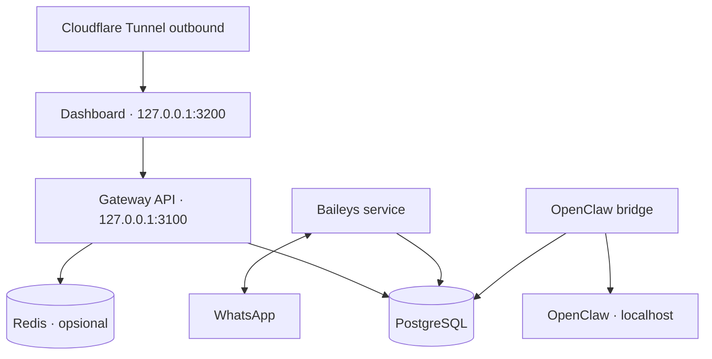
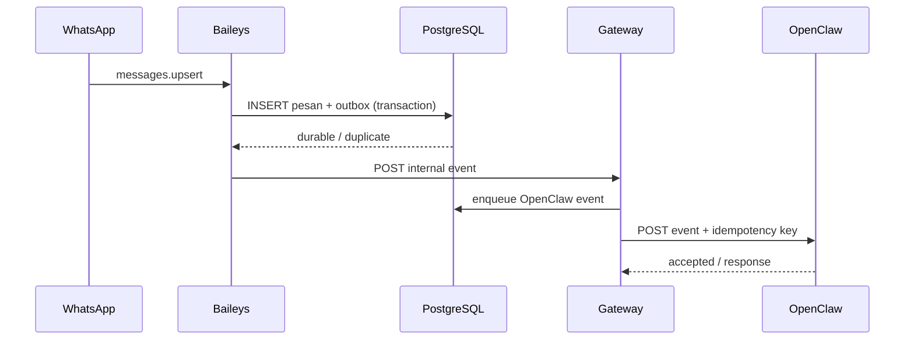

# Arsitektur Final

## Prinsip utama

OpenClaw WhatsApp Gateway adalah aplikasi workspace-local dengan proses terpisah untuk socket WhatsApp, API, bridge OpenClaw, maintenance, dan dashboard. Tidak ada daemon sistem, port publik, Docker, atau dependency OS yang dipasang oleh proyek. PostgreSQL memegang state durable; Redis opsional dan tidak pernah menjadi satu-satunya tempat antrean.

## Struktur repository

```text
openclaw-whatsapp-gateway/
├── .runtime/                  # PID, lock, release, socket, dan state process manager
├── apps/
│   ├── baileys-service/       # socket WhatsApp, auth state, receive/send worker
│   ├── gateway-api/           # admin API, internal bridge, health
│   └── dashboard/             # Next.js UI dan same-origin admin proxy
├── database/
│   ├── migrations/            # migration SQL immutable dan berurutan
│   ├── schema.sql             # snapshot PostgreSQL 14+
│   └── seed.sql               # seed non-secret
├── scripts/                   # lifecycle workspace-local
├── data/
│   ├── whatsapp/              # metadata non-secret/cache lokal bila dibutuhkan
│   ├── backups/
│   ├── uploads/
│   └── logs/
├── deployment/
│   ├── pm2/
│   └── cloudflare/
└── docs/
```

Folder `data/` tidak dikomit kecuali placeholder. Semua path runtime di-resolve dari project root, bukan current working directory proses.

## Topologi proses



Dashboard hanya meneruskan route admin yang diizinkan secara eksplisit. Route `/internal/*` tidak tersedia melalui origin dashboard. Cloudflare Tunnel menargetkan listener loopback dashboard; tidak ada listener `0.0.0.0` dan tidak ada inbound firewall rule yang diperlukan.

## Tanggung jawab komponen

### Baileys service

- Memiliki socket Baileys dan lifecycle reconnect.
- Menyimpan/membaca auth state terenkripsi.
- Menormalisasi event, melakukan exact mention detection, dan menyimpan inbound.
- Mengklaim job outbound secara atomik dan mengirim text/image/document/video/audio (termasuk voice note OGG Opus).
- Menulis receipt dan delivery event.
- Tidak memiliki provider AI, prompt reasoning, atau tool execution.

### Gateway API

- Login admin, JWT access, rotating refresh token, lockout, audit.
- CRUD profile, knowledge, tools, jobs, provider, setting, group, dan messages.
- Internal API key untuk bridge OpenClaw.
- Membuat command durable dan idempotent; tidak mengirim WhatsApp langsung dari request thread.
- Health liveness/readiness/integration.

### Dashboard

- UI operasional Bahasa Indonesia.
- Menyimpan access token hanya di memori dan refresh token dalam cookie HttpOnly/SameSite/secure.
- Menggunakan same-origin server route ke allowlist admin Gateway API.
- Tidak membaca kembali API key/provider secret yang sudah tersimpan.

## Ports dan binding

| Proses | Default | Binding | Eksposur |
|---|---:|---|---|
| Gateway API | 3100 | `127.0.0.1` | Internal workspace |
| Dashboard | 3200 | `127.0.0.1` | Melalui tunnel outbound |
| Baileys service | tidak wajib HTTP | n/a | Internal worker |
| PostgreSQL/Redis | dari environment | sesuai provider | Tidak diubah installer |

Port dapat diubah melalui `GATEWAY_PORT` dan `DASHBOARD_PORT`, tetapi production selalu menolak `HOST` non-loopback.

## Alur inbound



Untuk grup, `agent_mentioned=true` hanya jika JID agent terdapat di `contextInfo.mentionedJid`; pencocokan substring di text dilarang. Pesan tanpa mention dapat disimpan sebagai `ignored` untuk monitoring/retention, tetapi tidak dibuatkan outbox event.

## Alur outbound

1. OpenClaw memanggil `POST /internal/messages/send` dengan idempotency key.
2. Gateway memvalidasi tujuan/media, lalu dalam satu transaksi membuat `whatsapp_messages` dan `queue_jobs`.
3. API merespons accepted setelah commit.
4. Worker mengklaim row menggunakan transaksi dan `FOR UPDATE SKIP LOCKED`.
5. Setelah send, message dan delivery event diperbarui. Timeout/transient error menjadwalkan `available_at` menggunakan exponential backoff plus jitter.
6. Lease kedaluwarsa diklaim recovery worker. Setelah `max_attempts`, job menjadi `dead_letter` dan dapat di-requeue admin tanpa mengubah idempotency pesan (`dead` diterima sementara untuk kompatibilitas worker).

## Antrean dan Redis

PostgreSQL selalu menyimpan payload, attempts, lease, dedupe key, dan hasil. Redis dideteksi dan diuji sebagai dependency opsional untuk readiness serta perluasan koordinasi deployment, tetapi tidak menjadi sumber kebenaran antrean. Worker saat ini melakukan polling PostgreSQL dengan interval terkonfigurasi; karena itu Redis yang putus tidak mengubah durability atau menghentikan pemrosesan job.

Claim konseptual:

```sql
SELECT id
FROM queue_jobs
WHERE queue_name = $1
  AND status IN ('pending', 'available', 'retrying')
  AND available_at <= NOW()
ORDER BY priority ASC, available_at ASC, created_at ASC
FOR UPDATE SKIP LOCKED
LIMIT 1;
```

Update lock dan insert `queue_job_attempts` dilakukan dalam transaksi yang sama. External I/O dilakukan setelah commit; idempotency dan reconciliation menangani crash di antara send dan status update.

## Database discovery

Node.js/npm adalah bootstrap command dan build karena interface operasi diwajibkan memakai `npm run ...`. Bun yang kompatibel diprioritaskan oleh process runner untuk Gateway API/Baileys/bridge, sedangkan Next.js standalone tetap Node. Installer tidak mengklaim dukungan Bun-only.

Installer tidak memasang binary database. Ia mencari credential environment, metadata service yang tersedia, lalu endpoint localhost yang sudah berjalan. Bila `initdb` dan `pg_ctl` sudah disediakan environment tetapi tidak ada endpoint, installer boleh membuat cluster data workspace-local dengan SCRAM dan private Unix socket di `.runtime/`; tidak ada service global. Setiap kandidat diuji dengan timeout, `SELECT 1`, versi PostgreSQL, permission pembuatan tabel, dan advisory lock. Kandidat tidak dipilih hanya karena port terbuka.

PostgreSQL 14+ adalah minimum karena pola locking, JSONB, identity, dan fitur index yang digunakan. Bila tidak ditemukan, install berhenti sebelum build/start dan menampilkan environment yang harus diisi. Redis yang tidak ditemukan menghasilkan `QUEUE_DRIVER=postgres`, bukan kegagalan instalasi.

## Migration

- File migration bernama `NNNN_description.sql`, immutable setelah rilis.
- Runner mengambil advisory lock berbasis nama aplikasi.
- Checksum SHA-256 dibandingkan dengan `schema_migrations`.
- Runner membungkus setiap file dan pencatatan registry dalam satu transaksi; file SQL tidak membawa `BEGIN/COMMIT` sendiri. Runner berhenti pada checksum mismatch atau statement gagal.
- Seed dipisahkan dari schema. Seed admin tidak memiliki password hash; installer melakukan update parameterized setelah Argon2id selesai.

## Enkripsi dan secret

`WHATSAPP_SESSION_ENCRYPTION_KEY`, `SESSION_ENCRYPTION_KEY`, internal API key, JWT key, dan backup key berasal dari `.env` dengan permission ketat. Baileys auth state memakai versioned AES-256-GCM envelope: random nonce 96-bit, ciphertext, authentication tag, key version, dan AAD (`scope`, `key`). Master key tidak disimpan dalam database.

Password memakai Argon2id dan refresh token hanya disimpan sebagai hash. Internal API key aktif berada di `.env` owner-only dan hanya diteruskan ke proses yang memerlukannya; pembandingan dilakukan constant-time. Structured logger meredaksi path sensitif yang dikenal untuk authorization, cookie, key, token, password, session, dan QR; payload rahasia tidak boleh diberikan ke logger sebagai object arbitrer.

## Process management

Urutan prioritas:

1. PM2 yang sudah tersedia atau dipasang sebagai dependency workspace;
2. fallback runner Node/Bun yang menyimpan PID, lock, dan release state di `.runtime/` serta log di `data/logs`.

Tidak ada `pm2 startup`, `pm2 save` global, systemd, atau service OS. Perintah stop melakukan graceful shutdown: berhenti menerima job, melepas lease, flush auth state, menutup socket, pool database, dan Redis.

## Backup dan recovery

Backup adalah envelope versioned, encrypted, dan checksummed. Export logical dibatasi ukuran dan diambil melalui satu session `REPEATABLE READ`; artifact mencakup tabel durable, session/spool ciphertext, serta upload yang masih diperlukan command recoverable. Session tetap berupa ciphertext, dan keseluruhan artifact dienkripsi lagi dengan backup key. Restore melakukan preflight penuh sebelum menghentikan proses, membuat rescue backup, memulihkan file serta database, menjalankan migrations forward, dan tidak memutar ulang command pairing/logout/maintenance yang basi.

## Failure policy

| Kegagalan | Perilaku |
|---|---|
| PostgreSQL putus | Readiness gagal; intake tidak di-ack; reconnect dengan backoff |
| Redis putus | Degraded; queue PostgreSQL tetap berjalan |
| WhatsApp putus | Intake jaringan berhenti; job tersimpan; reconnect non-logout |
| OpenClaw putus | Outbox retry; pesan tidak hilang |
| Worker crash | Lease expiry dan reconciliation memulihkan job |
| Session gagal autentikasi | Berhenti reconnect agresif; minta QR baru; identity tetap utuh |
| Tunnel putus | Dashboard eksternal tidak tersedia; aplikasi lokal tetap berjalan |

## Keputusan yang dikunci

- Single tenant/admin/agent/account.
- Workspace-local tanpa privilege.
- PostgreSQL sebagai durable source of truth.
- Redis opsional.
- Baileys terpisah dari API dan dashboard.
- Cloudflare Tunnel outbound ke loopback dashboard.
- Gateway tanpa AI logic.

Setiap penyimpangan memerlukan ADR baru dengan motivasi, dampak migrasi, risiko, dan rollback.
